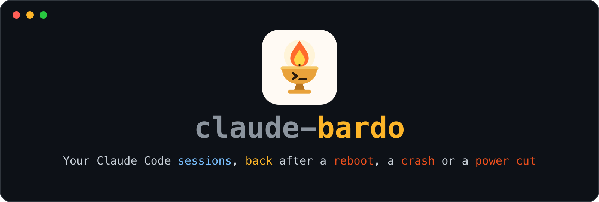
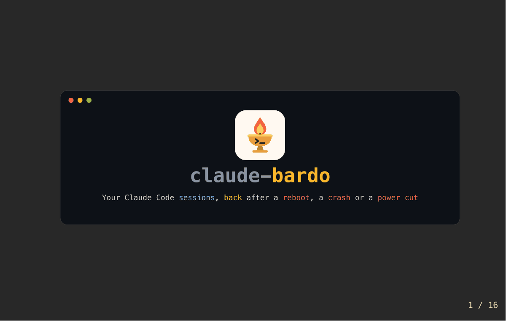

<p align="center"></p>

## The problem

You have a dozen Claude Code sessions open, across worktrees. Then the laptop reboots.

```text
 before                                     after
 ┌───────────────────────────────┐          ┌──────────────────────────┐
 │ ~/code/api    --model opus    │          │ $ claude --resume        │
 │ ~/code/web    --effort high   │  reboot  │                          │
 │ ~/code/ops    --add-dir ../db │  ─────►  │ fifty sessions a project │
 │ ~/code/docs   caffeinate -i   │          │ no windows, no flags     │
 └───────────────────────────────┘          └──────────────────────────┘
```

The conversations are still on disk. What is lost is the **desk**: which window each one lived in,
which directory, which flags it was started with. You rebuild it by hand, one session at a time.

## What claude-bardo does

It remembers every interactive session and brings back the ones that died:

- each in **its own window**
- in **its own directory**
- with **its own flags**
- **mid-conversation**

**One file.** Python 3.7+, standard library, no dependencies.

**No daemon.** Claude Code's own hooks do the recording.

**No network.** No sockets, no telemetry, no update check.

## Why "bardo"?

> In Tibetan Buddhism the *bardo* is the state between death and rebirth. The *Bardo Thödol*
> teaches that the dead who recognise the clear light are released, and the rest are carried back
> into rebirth by unfinished karma.

Same rule here:

| a session that | is |
|---|---|
| was ended on purpose (`/exit`, `/clear`, `/resume`) | **released** |
| died with unfinished work (crash, reboot, power cut) | **brought back** |

`claude-bardo list` shows who is in the in-between.

## Install it once

```sh
mkdir -p ~/.local/bin               # it must be on your PATH, and macOS does not put it there
curl -fsSLo ~/.local/bin/claude-bardo https://raw.githubusercontent.com/multiplyco/claude-bardo/main/claude-bardo
chmod +x ~/.local/bin/claude-bardo
claude-bardo install --dry-run      # shows the two hooks it would add to ~/.claude/settings.json
claude-bardo install                # adds them (with a backup), registers what is running now
```

That is the whole setup.

- Every session **registers itself** as it starts and **records how it ended**, so there is
  nothing to remember to run before a reboot.
- `install` backs up `~/.claude/settings.json` and never touches anyone else's hooks.
- `snapshot` exists only for sessions that were already running when you installed, and
  `install` runs it for you.

[fzf](https://github.com/junegunn/fzf) makes the picker nicer. macOS first; Linux works with
`restore --tmux`. `man claude-bardo` works after installing from a clone.

## After a reboot or a crash

```sh
claude-bardo            # what died, what is live
claude-bardo restore    # picker, the last crash pre-selected: press Enter
```

What `claude-bardo` shows (illustrative):

```text
id        status        age  name               directory
01a0fbe7  live           1m  release notes      ~/code/docs
01a0fad5  interrupted    6m  refactor billing   ~/code/api
01a0fb43  interrupted    6m  landing page copy  ~/code/web
01a0f6c1  killed         6m  infra migration    ~/code/ops
01a0e74e  interrupted    3d  auth spike         ~/code/api
```

The three that died 6 minutes ago went down together, in the last crash or reboot: `restore`
pre-selects them. The one from 3 days ago is listed below them, unselected.

## The tour in slides

<p align="center"></p>

The same story in sixteen slides, for a talk or a first look. The deck is plain markdown,
[`docs/presentation.md`](docs/presentation.md), written for
[presenterm](https://github.com/mfontanini/presenterm). To step through it in your terminal:

```sh
presenterm docs/presentation.md
```

Rebuild the GIF after editing the deck: `docs/render-gif.sh`

## How it works

```text
 claude starts ──► SessionStart hook ──┐
                                       ├──► registry.jsonl
 claude ends ────► SessionEnd hook ────┘    a JSON line per start and end:
                   (with a reason)          directory, exact flags, pid,
                                            transcript, end reason
 kill -9, power cut: no hook runs,
 but ~/.claude/sessions/<pid>.json lingers
```

```text
 claude-bardo restore
   1. fold the registry and Claude Code's process files into a status
   2. open the picker, the latest wave pre-selected
   3. a new window each:  cd <dir> && claude <flags> --resume <id>
```

No daemon, no polling: Claude Code calls the hook, the hook appends a line.

## How it knows what died

Claude Code tells a hook when a session starts and ends, and keeps a file per running process.
What each death leaves behind (measured on Claude Code 2.1.285 by [`qa/run.py`](qa/)):

| what happened             | what Claude Code leaves                                  | status        |
|---------------------------|----------------------------------------------------------|---------------|
| terminal crash (SIGHUP)   | SessionEnd, reason `other`                               | `interrupted` |
| reboot, macOS logout (SIGTERM) | SessionEnd, reason `other`                          | `interrupted` |
| `kill -9`, power loss     | no SessionEnd, but `~/.claude/sessions/<pid>.json` lingers | `killed`      |
| `/exit`, `/clear`, `/resume`, `/logout` | SessionEnd, reason `prompt_input_exit` / `clear` / `resume` / `logout` | `closed` |

- `interrupted` and `killed` come back. `closed` never does.
- An end reason it has never seen counts as a crash, and says so: losing a session is the one
  failure this tool exists to prevent.

## The latest wave

Closing a terminal window is a SIGHUP too, so the registry also remembers sessions you closed days
ago. A reboot or a crash kills everything within seconds.

```text
 older deaths (windows you closed)             the latest wave
 ─────●───────────────●───────────────────────●●●●─────►  time
   Mon 14:02       Wed 11:40               Fri 09:12
     [ ]             [ ]                  [x][x][x][x]
 listed below, unselected             pre-selected: press Enter
```

- The picker pre-selects the sessions that died within **30 minutes** of the newest death.
- Older deaths are listed below it, unselected. `forget` drops one for good.
- `restore` hides deaths older than 14 days unless you pass `--older`.

## What gets replayed

A restored session runs `claude <flags> --resume <id>` in its original directory. The flags come
from the process's **exact argv** (the kernel's, not `ps` text, so a quoted value stays whole).

- **Replayed:** known flags and their values (`--model`, `--effort`, `--permission-mode`,
  `--settings`, `--add-dir`, `--mcp-config`, ...), and a `caffeinate -i -- claude` wrapper.
- **Never:** the prompt typed after `claude` (it is not even stored), session selectors
  (`--resume`, `--continue`, `--session-id`, `--name`), one-shot modes (`-p`, `--bg`), and
  `--worktree` (the directory already is the worktree).
- **Dropped unless `restore --keep-bypass`:** permission bypass in every spelling
  (`--dangerously-skip-permissions`, `--allow-dangerously-skip-permissions`,
  `--permission-mode bypassPermissions`, a `--settings` that sets it). The login agent never
  keeps it.
- **Dropped and named** in the restored window: flags newer than this release, which knows Claude
  Code 2.1.301. `doctor` warns when your Claude Code is newer, and points you at [Update](#update).

Why drop the bypass? Killing a terminal is the emergency stop for a runaway agent, and this tool
counts that as a crash. **A crash must not re-arm it.**

## Rehearse it without rebooting

Not sure it will all come back? Try it without touching anything running:

```sh
claude-bardo restore --fork --terminal iterm     # every LIVE session, copied into iTerm windows
```

- Each copy runs `claude --resume <id> --fork-session`: same directory, same flags, the whole
  conversation, under a **new** session id.
- The originals keep running where they are.
- A full dress rehearsal of a restore, and a way to move your working set to another terminal app.

The copies are real sessions. When you are done, quit that terminal and clean them up:

```sh
claude-bardo forget --forks      # closes every copy that has died
```

(Closing a window counts as a crash, so otherwise the copies would wait in the picker.)

## Commands

| command | does |
|---|---|
| `list` | what died, what is live (the default). `--all` adds closed ones, `--json` for tools |
| `restore [ids]` | picker (latest wave pre-selected), `--all`, or id prefixes. `--tmux`, `--terminal APP`, `--dry-run`, `--older` |
| `restore --fork` | open a **copy** of your live sessions (new ids, same history): rehearse a restore, originals untouched |
| `resume <id>` | bring one session back in *this* terminal |
| `forget <ids>` | "I closed that one on purpose": it leaves the picker |
| `prune` | drop closed and unresumable history older than `--days` (30) |
| `snapshot` | register sessions that were running before you installed |
| `doctor` | check the hooks, the state dir, the terminal, and every Claude Code internal it relies on |
| `install` / `uninstall` | hooks in `settings.json` (never touching anyone else's), optional `--launchd` login agent |

Exit codes: `0` ok, `1` failure, `2` usage, `3` nothing to restore or nothing selected.

## Terminals, and the login agent

Sessions come back in **Ghostty** by default. Set `CLAUDE_BARDO_TERMINAL` (or pass `--terminal`)
to `iterm`, `terminal`, `alacritty`, `wezterm` or `kitty`, or use `restore --tmux` from any
terminal, also on Linux. Any other terminal, through a template:

```sh
export CLAUDE_BARDO_LAUNCHER='myterm --new-window -e {cmd}'
```

Ghostty, iTerm and tmux are covered by the QA run; the others follow their documented CLIs.
iTerm and Terminal are driven by AppleScript, so macOS asks once for Automation permission.

```sh
claude-bardo install --launchd
```

adds a login agent: if anything died in the last shutdown, it opens **one** window with the
picker. Nothing relaunches until you press Enter, and it never keeps a permission bypass.

## Configuration

| variable | default |
|---|---|
| `CLAUDE_BARDO_DIR` | `~/.local/state/claude-bardo`: the registry and log |
| `CLAUDE_BARDO_TERMINAL` | `ghostty` |
| `CLAUDE_BARDO_LAUNCHER` | unset; a command template with a `{cmd}` token |
| `CLAUDE_CONFIG_DIR` | `~/.claude`, as in Claude Code |

## Safety and limits

**Safe by design**

- **No network.** No sockets, no telemetry, no update check. The only thing that goes online is
  the `claude --resume` you choose to run.
- **Transcripts are read, not copied.** To show a title and a directory it reads three top-level
  fields (`cwd`, `customTitle`, `aiTitle`). Message content is never stored or logged.
- **What it stores:** one JSON line per session start and end: time, session id, pid, working
  directory, title, transcript path, terminal, Claude Code version, and the flags you launched
  claude with. Flag values can be sensitive (an `--append-system-prompt`, inline `--settings`
  JSON); directory names and titles can name clients. Beside it, `transcripts.json` remembers
  each transcript's directory and titles and how far it was read, so the next command reads only
  what was appended since.
- **Private files:** the state dir is `0700`, its files `0600`, fixed up if they were not.
- **Retention:** `prune` drops old history; `rm -rf ~/.local/state/claude-bardo` (or
  `uninstall --purge`) erases everything it ever recorded.
- A crash never re-arms a permission bypass.

**Honest limits**

- It leans on Claude Code internals that are **not a documented API** (listed
  [below](#what-it-relies-on-in-claude-code)). `doctor` checks each one, and each degrades quietly.
- Flags are verified on Claude Code **2.1.301**: newer ones are dropped and named.
- **macOS first.** Linux works with `restore --tmux`.
- A **closed window looks like a crash**: it waits in the list until you `forget` or `prune` it.
- Interactive sessions only, not `claude -p` or SDK runs.

## Build on it

The registry is `registry.jsonl`, append-only apart from `prune`, one event per line:

```json
{"v":1,"ts":"…","event":"start","session_id":"…","cwd":"…","name":"…","source":"startup","pid":123,
 "argv":["claude","--model","opus"],"argv_exact":true,"claude_path":"…","caffeinate":null,
 "proc_start":"…","transcript":"…","term":"ghostty","version":"2.1.285","anc":[[122,"zsh","…"],[99,"ghostty","…"]]}
{"v":1,"ts":"…","event":"end","session_id":"…","reason":"other","pid":123}
{"v":1,"ts":"…","event":"probe","session_id":"…","at":"end","anc":[…],"terms":[[99,"ghostty","…"]]}
{"v":1,"ts":"…","event":"restoring","session_id":"…"}
{"v":1,"ts":"…","event":"launch-failed","session_id":"…","rc":1,"seconds":0.4}
```

`anc` (the process's ancestors: pid, name, start time) and `probe` (the ancestors and the live
terminals when a session ends) are measurements for a proposed change, not yet read by anything.
Readers must ignore unknown fields and event types; `v` changes only on a breaking change. Rather
than re-folding the events yourself, use `claude-bardo list --json`: one object per session with
its `status`, `note`, and the exact `command` a restore would run. `_launch <id>` is what spawned
windows run; it is stable within a major version.

## What it relies on in Claude Code

None of this is a documented API, so `doctor` checks it and every part degrades quietly:

| internal | if it changes |
|---|---|
| `SessionStart` / `SessionEnd` hook input and reasons | new reasons count as crashes and say so |
| `CLAUDE_PID` in the hook's environment | falls back to walking up the process tree |
| `~/.claude/sessions/<pid>.json` | `kill -9` and power-loss deaths are no longer detected |
| `~/.claude/projects/*/<id>.jsonl` | sessions show as unresumable |
| `customTitle` / `aiTitle` transcript records | names fall back to the directory |

## Testing

```sh
python3 -m unittest discover -s tests       # 95 tests, a few seconds, touches nothing real
python3 qa/run.py                            # end to end: real sessions, crashed four ways, restored
```

The [QA runner](qa/) starts five real Claude Code sessions (in iTerm, or a private tmux server
with `--backend tmux`), kills them with SIGHUP, SIGTERM, SIGKILL and `/exit`, restores them, and
checks that the right four came back with their flags and their memory. It never touches your
own sessions, hooks or registry.

## Update

Run the curl line again. The hooks call `~/.local/bin/claude-bardo` by its path, so replacing that
file is the whole update. Running `install` again is safe: it changes nothing unless the new
version needs something new.

```sh
curl -fsSLo ~/.local/bin/claude-bardo https://raw.githubusercontent.com/multiplyco/claude-bardo/main/claude-bardo
claude-bardo install                # "already up to date", unless the new version adds a hook
```

From a clone, `git pull && ./claude-bardo install` copies the new version into place. There is no
update check, on purpose: claude-bardo makes no network connections.

## Uninstall

```sh
claude-bardo uninstall            # hooks first, then the login agent, then the binary
claude-bardo uninstall --purge    # and the registry
```

## Prior art

[tmux-resurrect](https://github.com/tmux-plugins/tmux-resurrect) had the idea for shells. For
Claude Code: [claude-revive](https://github.com/Livshitz/claude-revive) (reboot heuristics and a
TUI), [claude-resurrect](https://github.com/msllrs/claude-resurrect) (Ghostty window layouts) and
[claude-revive](https://github.com/overnightworks/claude-revive) (Linux, GNOME). claude-bardo's
angle: exit semantics from the hooks instead of heuristics, exact flag replay, no daemon.

## License

Eclipse Public License 2.0. Copyright (c) 2026 Multiply. See [LICENSE](LICENSE).
